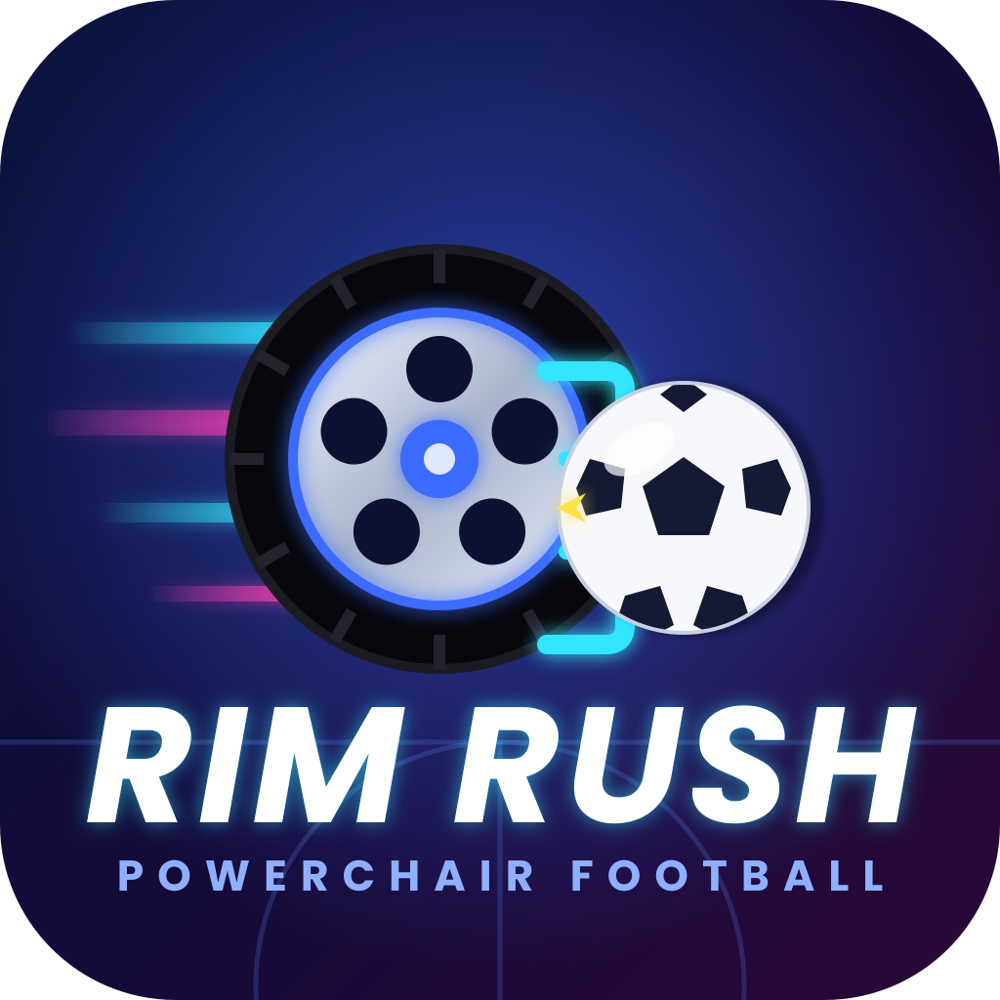
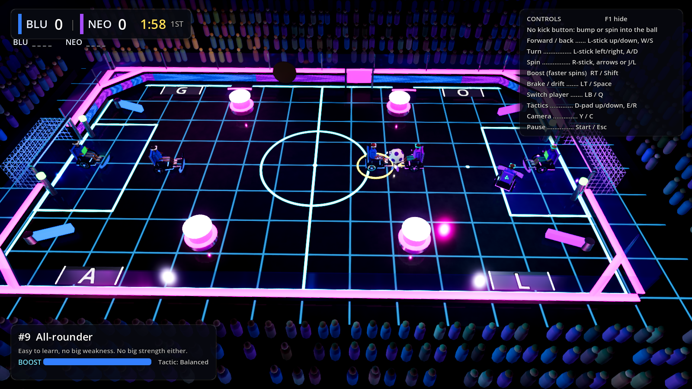
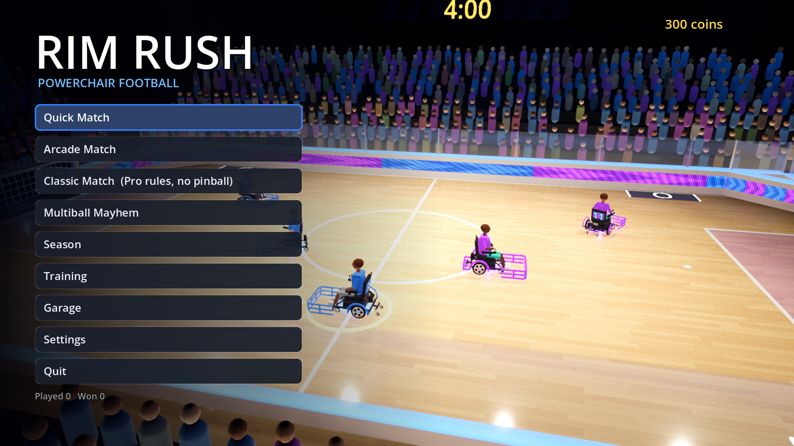
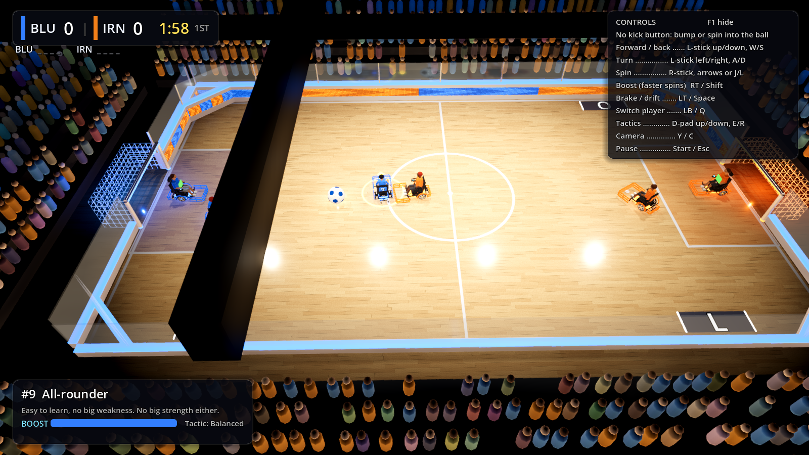
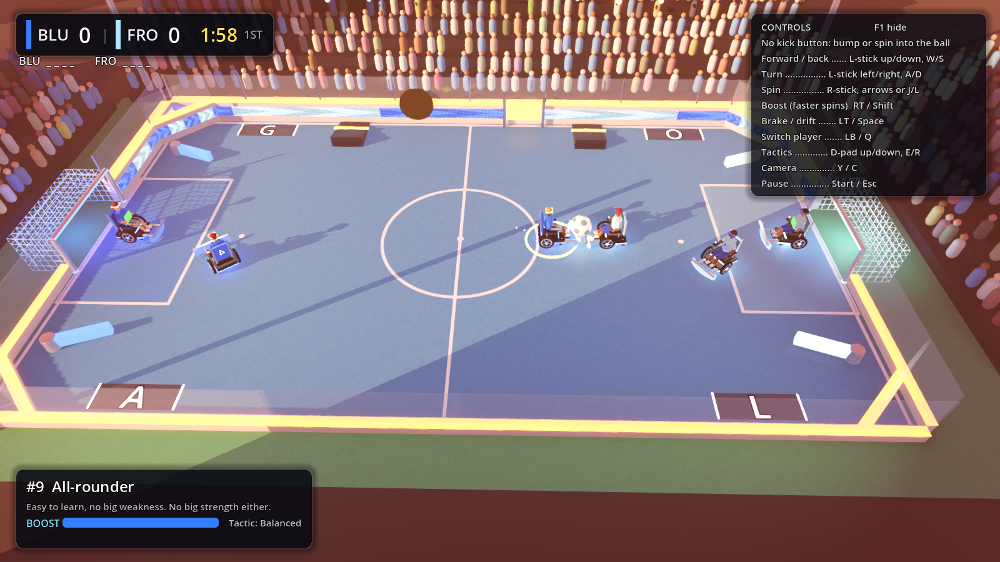
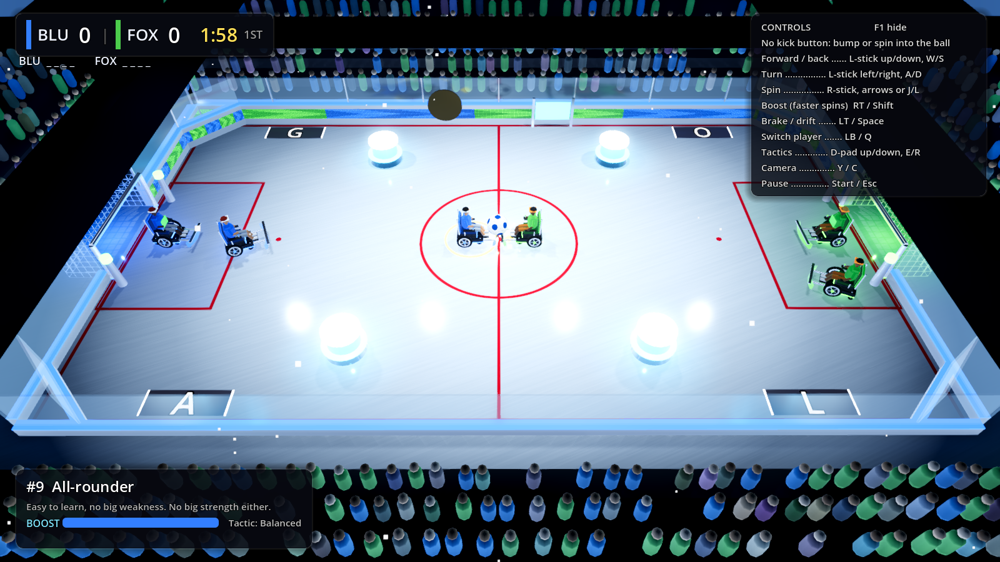
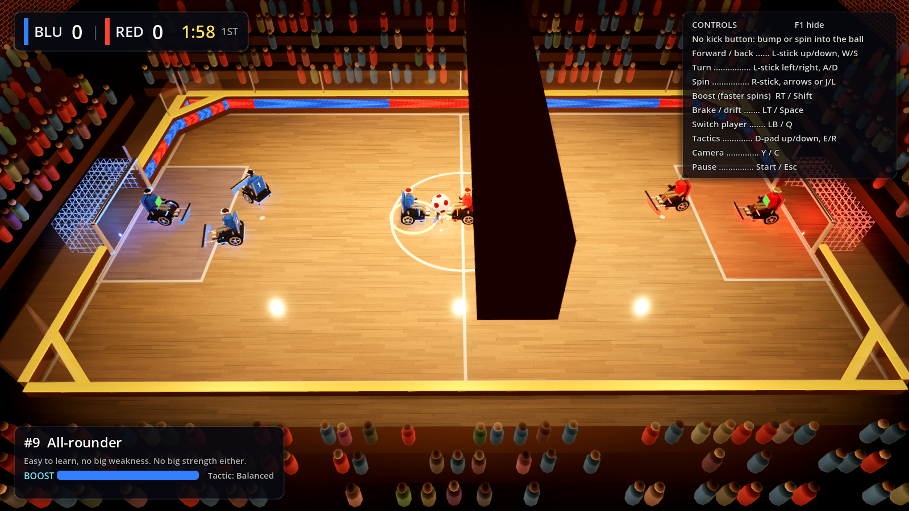
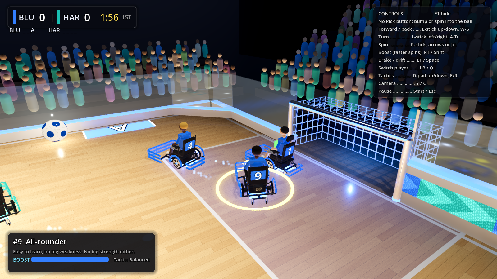

# Rim Rush: Wheelchair Soccer

**Play in your browser:** https://joshuamrumack-collab.github.io/rim-rush/ (works in Chrome or Edge on a computer; click once to turn on the sound)

3D powerchair football for Godot 4.7, inspired by FIFA, Rocket League and pinball. Open the folder in Godot 4.7 and press F5. Everything (graphics, sound, arenas) is generated in code and shaders, so there are no asset files to import.

## Modes
- **Quick Match**: random arena and opponent.
- **Arcade Match**: pick the arena, opponent, 2v2 / 3v3 / 4v4 (keepers from 3v3), Arcade or Pro rules, half length and difficulty.
- **Classic Match**: Retro Gym, Pro rules, no pinball.
- **Multiball Mayhem**: three balls the whole match.
- **Season**: 7 rival clubs, a league table, saved between sessions. Win it for +500 coins.
- **Training**: Power Spin, Target Practice, Slalom, Bank Shots, Keeper Saves. Each awards up to 3 stars (+40 coins per new star).
- **Garage**: chair type, 5 part slots (frame, guard, motor, battery, wheels) with trade-offs, and paint. Parts cost coins.
- **Settings**: one-hand mode, auto-switch, colour-blind team shapes, reduce flashing, camera shake, chase camera, game speed (60-100%), aim assist, volume, difficulty, team size.

## Match flow
Intro fly-in, countdown, two halves with a half-time stats screen and an end swap, Overtime Fever (goals count double in the last 30 s), golden goal if tied (not in Season), goal celebration with a slow-motion replay (skippable), and a full-time stats screen with coins.

**Rules:** Arcade only punishes fast hits from behind (3 s boost lockout). Pro adds the 2-on-1 rule and a max of 2 defenders in the goal area, both giving a free kick.

## Arenas
| Arena | Look | Pinball |
| --- | --- | --- |
| Indoor Court | Parquet floor, floodlights, full crowd | G-O-A-L lanes |
| Neon Arcade | Dark glossy floor, neon, sweeping lights | Bumpers, flippers, lanes, spinner, ramps, kickbacks, events |
| Rooftop City | Sunset sky and skyline | Flippers, lanes, spinner, ramps, events + wind gusts |
| Retro Gym | Brick walls, old wood | None (Pro rules) |
| Ice Rink | Ice floor (low grip), snow | Bumpers, lanes, spinner, kickbacks, events |

**Events** come every 25-40 s after the first minute, with a 3 s warning: Multiball, Jackpot (hit the gold target, then score within 10 s for x3), Magnet field, Blackout and Wind (Rooftop only).

## Controls
No kick button. Bump the ball, or spin so your foot guard swings into it.

| Action | Gamepad | Keyboard |
| --- | --- | --- |
| Forward / reverse | Left stick up / down | W / S |
| Turn | Left stick left / right | A / D |
| Spin | Right stick left / right | Arrows or J / L |
| Boost (faster spins too) | RT | Shift |
| Brake / drift | LT | Space |
| Switch player | LB | Q |
| Tactics | D-pad up / down | E / R |
| Camera (broadcast / chase) | Y | C |
| Pause | Start | Esc |
| Help | | F1 |

**One-hand mode:** the left stick points where to go, and A (or K) spins toward the ball, toward goal.

## Code
`scripts/`: `game_state.gd` (autoload: settings, save, teams, parts, season), `sfx.gd` (autoload: synthesized sound), `menu.gd`, `match.gd` (rules, events, replay, training), `arena.gd` (all 5 arenas, lights, crowd), `pinball.gd`, `chair.gd`, `ball.gd`, `ai.gd`, `hud.gd`, `fx.gd`, `mk.gd`, `ui_theme.gd`. `shaders/`: floor (court markings), ball, net, LED boards, crowd, city windows, brick.

Save file: `user://rimrush_save.json`.

## Screenshots
| | |
| --- | --- |
|  |  |
|  |  |
|  |  |

## Web build
`export_presets.cfg` has a "Web" preset (single-threaded, so it runs on GitHub Pages). Export it to `build/web/` and push that folder to the `gh-pages` branch.
